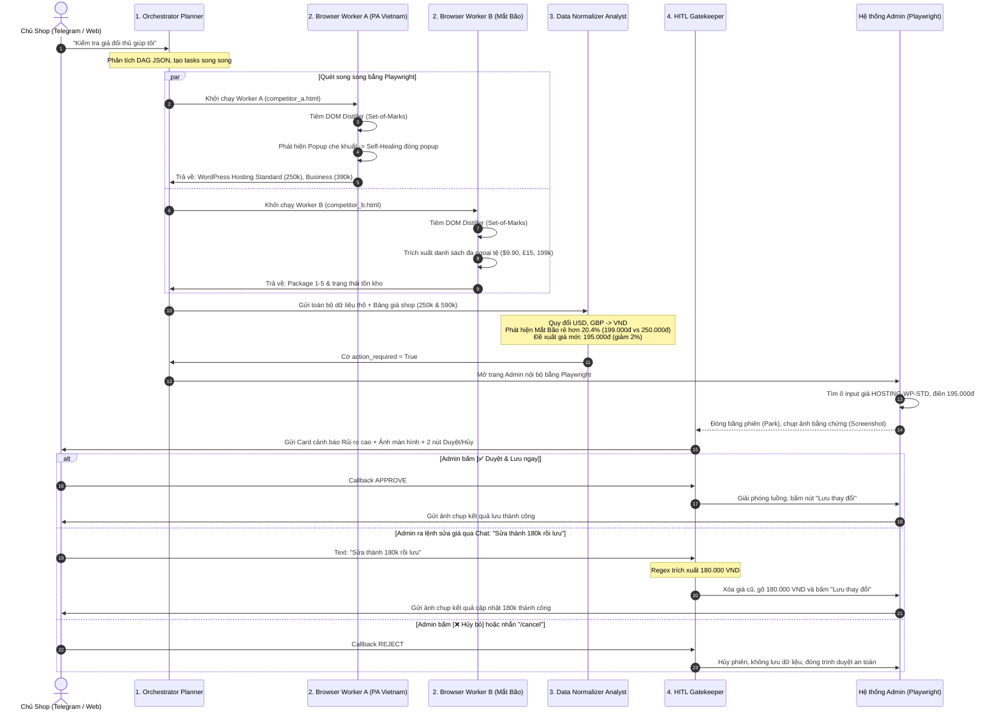

# 🚀 HỆ THỐNG CROSS-PLATFORM WEB ACTION AGENT (RPA 2.0)
> **Kiến trúc Multi-Agent Tự động hóa Trình duyệt Điều khiển bởi LLM kết hợp Cổng An toàn Human-in-the-Loop (HITL) và Tương tác 2 Chiều qua Telegram**

---

## 📌 1. TỔNG QUAN KIẾN TRÚC HỆ THỐNG

Dự án là nền tảng **RPA 2.0 thế hệ mới**, giải quyết triệt để các nhược điểm của RPA truyền thống (dễ gãy khi UI thay đổi, không hiểu ngữ cảnh, rủi ro khi ghi đè dữ liệu sai lệch) bằng cách kết hợp:
1. **Multi-Agent Pipeline (4-in-1 Unified System Prompt)**: Một System Prompt thống nhất chuyển trạng thái linh hoạt qua 4 vai trò chuyên biệt.
2. **DOM Distillation & Set-of-Marks (SoM)**: Thu gọn DOM thực tế, đánh dấu tương tác `[1..N]` lên màn hình giúp LLM quan sát trực quan.
3. **Cơ chế Tự phục hồi (Self-Healing)**: Tự phát hiện và vượt qua Modal Popup, Promo Banner, Cookies hoặc lỗi click bị che khuất mà không cần người can thiệp.
4. **Cổng kiểm soát an toàn Human-in-the-Loop (HITL Gatekeeper)**: Điền sẵn toàn bộ dữ liệu lên hệ thống đích (Admin) nhưng **đóng băng phiên Playwright** và đợi người quản trị duyệt hoặc chỉ định giá mới qua Telegram / Dashboard trước khi Submit.
5. **Dual-Mode Resilient URL Resolver**: Tự động chuyển đổi giữa HTTP Local (`http://127.0.0.1:8000`) và File URI cục bộ (`file:///...`) để bảo đảm hệ thống chạy mượt mà ngay cả khi web server offline.

```
                    ┌──────────────────────────────────────────────┐
                    │          Yêu cầu Tiếng Việt tự nhiên         │
                    │   (Từ Telegram Bot / API / Web Dashboard)    │
                    └──────────────────────┬───────────────────────┘
                                           │
                                           ▼
                    ┌──────────────────────────────────────────────┐
                    │      1. ORCHESTRATOR_PLANNER (DAG Plan)      │
                    │  Phân rã nhiệm vụ cào đa luồng & quy tắc giá │
                    └───────┬──────────────────────────────┬───────┘
                            │                              │
             (Song song luồng 1)                    (Song song luồng 2)
                            ▼                              ▼
             ┌─────────────────────────────┐┌─────────────────────────────┐
             │   2. BROWSER_WORKER (A)     ││   2. BROWSER_WORKER (B)     │
             │  • Playwright Chromium      ││  • Playwright Chromium      │
             │  • Set-of-Marks DOM overlay ││  • Set-of-Marks DOM overlay │
             │  • Self-Healing vượt popup  ││  • Vô hạn scroll / Paginate │
             └──────────────┬──────────────┘└──────────────┬──────────────┘
                            │                              │
                            └──────────────┬───────────────┘
                                           │ (Dữ liệu thô: 199k, $9.90, £15)
                                           ▼
                    ┌──────────────────────────────────────────────┐
                    │       3. DATA_NORMALIZER_ANALYST             │
                    │  • Quy đổi ngoại tệ (USD, GBP -> VND)        │
                    │  • Chuẩn hóa tồn kho (IN_STOCK, LIMITED...)  │
                    │  • So sánh giá niêm yết shop với đối thủ     │
                    │  • Kích hoạt cảnh báo nếu rẻ hơn >= 10%      │
                    └──────────────────────┬───────────────────────┘
                                           │ (Phát hiện đối thủ rẻ hơn)
                                           ▼
                    ┌──────────────────────────────────────────────┐
                    │     4. SENSITIVE MUTATION & LIVE STAGING     │
                    │  • Playwright mở trang Admin nội bộ          │
                    │  • Điền sẵn giá mới đề xuất vào ô Input      │
                    │  • KHÔNG bấm Submit -> Treo phiên (Parked)   │
                    └──────────────────────┬───────────────────────┘
                                           │
                                           ▼
                    ┌──────────────────────────────────────────────┐
                    │       5. HITL GATEKEEPER & 2-WAY CHAT        │
                    │  • Bắn ảnh Screenshot & nút Duyệt/Hủy        │
                    │  • Admin duyệt: Playwright bấm Lưu ngay      │
                    │  • Admin chat: "Sửa thành 180k rồi lưu"      │
                    │    -> Gõ lại giá mới và Submit tức thì       │
                    └──────────────────────────────────────────────┘
```

---

## 🔄 2. SƠ ĐỒ QUY TRÌNH HOẠT ĐỘNG CHI TIẾT (SEQUENCE DIAGRAM)



---

## 🎭 3. CHI TIẾT 4 VAI TRÒ ĐIỀU PHỐI (4-IN-1 MULTI-AGENT PIPELINE)

Hệ thống sử dụng **1 Unified System Prompt** chứa đầy đủ định nghĩa nghiệp vụ và luân chuyển qua cờ `[ACTIVE_ROLE: ...]`:

### 🔹 Vai trò 1: `ORCHESTRATOR_PLANNER`
- **Đầu vào**: Câu lệnh tự nhiên tiếng Việt từ người dùng (VD: *"Quét giá hosting đối thủ, nếu bên nào rẻ hơn 10% thì cập nhật"*).
- **Cơ chế**:
  - Đọc cấu hình danh mục sản phẩm của shop (`OUR_CATALOG`).
  - Lập đồ thị kế hoạch thực thi (DAG Plan) định dạng JSON.
  - Tách các nhánh `parallel_worker_tasks` chạy đồng thời Playwright mà không phụ thuộc lẫn nhau.
  - Khai báo quy tắc nghiệp vụ `business_rule_evaluation` và tác vụ nhạy cảm `mutation_action_task` có cờ `requires_hitl_approval: true`.

### 🔹 Vai trò 2: `BROWSER_WORKER`
- **Đầu vào**: Từng mục tiêu web (`start_url`, `goal`, `target_fields`).
- **Cơ chế**:
  - **Set-of-Marks DOM Distiller**: Trước mỗi bước, tiêm `dom_distiller.js` quét toàn bộ phần tử tương tác hiển thị, gắn nhãn số định danh `data-agent-id="[1..N]"` và vẽ khung viền màu trực quan.
  - **Vòng lặp ReAct**: `Observe` (Ảnh chụp Set-of-Marks + DOM rút gọn) $\rightarrow$ `Think` (Lý giải hành động) $\rightarrow$ `Act` (`CLICK`, `TYPE`, `SCROLL_DOWN`, `PRESS_KEY`, `EXTRACT_DATA`).
  - **Cơ chế Tự phục hồi (Self-Healing)**: Nếu gặp `TimeoutError`, `ElementClickIntercepted` hoặc phát hiện Popup/Modal che phủ (như `#promoClose`, `.modal-close`, phím `Escape`), worker lập tức kích hoạt tự đóng popup rồi thử lại hành động trước đó.
  - **Chốt chặn an toàn**: Với tác vụ sửa đổi dữ liệu, worker chỉ điền thông tin vào form, **tuyệt đối không bấm nút Submit cuối cùng**, mà trả về `REQUEST_HITL_APPROVAL` và giữ nguyên phiên Playwright.

### 🔹 Vai trò 3: `DATA_NORMALIZER_ANALYST`
- **Đầu vào**: Dữ liệu thô hỗn tạp từ tất cả Browser Workers (VD: `"199k/tháng"`, `"250.000đ"`, `"$9.90"`, `"£15.00"`, `"Sắp hết"`, `"Còn hàng"`).
- **Cơ chế**:
  - Chuẩn hóa tiền tệ về số nguyên VND theo bảng tỷ giá quy chuẩn (`USD = 25,400`, `GBP = 32,000`).
  - Chuẩn hóa tình trạng kho hàng (`IN_STOCK`, `LIMITED`, `OUT_OF_STOCK`).
  - Đối chiếu với giá niêm yết hiện tại của shop:
    $$\Delta\% = \frac{\text{Giá đối thủ} - \text{Giá shop}}{\text{Giá shop}} \times 100$$
  - Nếu đối thủ **còn hàng** và **rẻ hơn từ 10% trở lên**, kích hoạt `action_required: true` và đề xuất mức giá mới tối ưu:
    $$\text{Giá đề xuất} = \min(\text{Giá đối thủ}) \times 0.98$$

### 🔹 Vai trò 4: `HITL_GATEKEEPER`
- **Đầu vào**: Yêu cầu phê duyệt `ApprovalRequest` chứa đánh giá mức độ rủi ro (`MEDIUM`, `HIGH`, `CRITICAL`), biên độ chênh lệch giá, ảnh chụp màn hình form trước khi bấm lưu.
- **Cơ chế**:
  - Đóng băng luồng xử lý trên `asyncio.Event`.
  - Gửi thẻ duyệt qua **Telegram Bot** và **Web Dashboard**.
  - **Hỗ trợ Chat 2 chiều**: Quản trị viên có thể bấm nút trực tiếp hoặc nhắn tin điều chỉnh giá theo ý muốn (`Sửa thành 180k rồi lưu`). Trình duyệt Playwright sẽ gõ trực tiếp giá mới vào trang Admin và tiến hành Lưu.

---

## 🛡️ 4. CÁC CƠ CHẾ ĐẶC BIỆT NÂNG CAO

| Cơ chế | Vấn đề trong thực tế | Giải pháp đột phá của RPA 2.0 |
|---|---|---|
| **Dual-Mode URL Fallback** | Khi test local hoặc web server cổng 8000 bị ngắt kết nối, Playwright bị crash với lỗi `net::ERR_CONNECTION_REFUSED` | `_resolve_url()` tự động kiểm tra cổng 8000 trong 0.2s. Nếu server chưa mở, tự động nạp thẳng file cục bộ (`file:///.../demo_targets/...`) giúp hệ thống không bao giờ bị gián đoạn. |
| **Live Form Staging** | RPA thông thường tự bấm Submit hoặc chỉ đưa ra cảnh báo tĩnh mà không chuẩn bị sẵn form | Giữ nguyên phiên Playwright (`park_on_hitl=True`), điền sẵn giá mới. Khi Admin duyệt, chỉ mất 0.5s để bấm Submit và hoàn tất. |
| **Chat Override theo ý Admin** | Chủ shop không đồng ý với giá AI đề xuất hoặc muốn áp dụng mức giá riêng | Parser trích xuất giá tự nhiên từ tin nhắn chat (`180k` $\rightarrow$ `180000`). Hệ thống tự động điền lại giá và lưu tức thì. |
| **Phân loại Ý định Thông minh** | Chatbot dễ nhầm lẫn giữa câu hỏi tra cứu và lệnh kích hoạt cào dữ liệu | Tách biệt bộ lọc câu hỏi (`bao nhiêu`, `thế nào` $\rightarrow$ Đọc cache trả lời ngay) và lệnh chạy (`quét giá`, `/run` $\rightarrow$ Khởi chạy RPA). |

---

## 📂 5. CẤU TRÚC THƯ MỤC DỰ ÁN

```
c:\AIagent2\rpa-mvp\
├── app/
│   ├── config.py             # Cấu hình Pydantic (LLM, Telegram, Timeouts, Demo URLs)
│   ├── main.py               # FastAPI App entrypoint, Static files, Lifespan poller
│   ├── schemas.py            # Pydantic Schemas (AgentTurn, DAG, ApprovalRequest...)
│   ├── routers/
│   │   ├── dashboard.py      # Giao diện điều khiển Web Dashboard & WebSocket event stream
│   │   ├── run.py            # REST API khởi chạy workflow (/api/run, /api/hitl/callback)
│   │   └── telegram.py       # Webhook & Polling router nhận tin nhắn từ Telegram
│   ├── services/
│   │   ├── prompts.py        # UNIFIED_SYSTEM_PROMPT chứa trọn vẹn 4 Roles & CoT Guard
│   │   ├── llm_rotator.py    # Multi-provider LLM Client (Anthropic Sonnet 5, Gemini fallback)
│   │   ├── orchestrator.py   # Lập lịch DAG, điều phối Worker song song & Staging form
│   │   ├── browser_worker.py # Playwright Worker, Set-of-Marks, Self-Healing, URL fallback
│   │   ├── normalizer.py     # Chuẩn hóa tiền tệ, tỷ giá FX, tính toán quy tắc giá
│   │   ├── hitl_gate.py      # Quản lý hàng đợi phê duyệt, Event lock, xử lý Override
│   │   ├── telegram_bot.py   # Trợ lý 2 chiều: Xử lý chat tự nhiên, gửi ảnh, trích xuất giá sửa
│   │   └── event_bus.py      # Pub/Sub thời gian thực truyền sự kiện lên giao diện Web
│   └── static/
│       ├── dashboard.js      # Giao diện React hiển thị luồng sự kiện & ảnh chụp trực tiếp
│       └── dom_distiller.js  # Script tiêm Set-of-Marks đánh số [1..N] và trích xuất DOM
├── demo_targets/
│   ├── competitor_a.html     # Trang web đối thủ A (PA Vietnam) có popup modal khuyến mãi
│   ├── competitor_b.html     # Trang web đối thủ B (Mắt Bão) có vô hạn scroll & đa ngoại tệ
│   └── admin.html            # Cổng quản trị nội bộ shop dùng để demo cập nhật bảng giá
├── .env                      # API keys (Anthropic Sonnet-5, Telegram Token, Chat ID)
└── README.md                 # Tài liệu quy trình và hướng dẫn chi tiết
```

---

## 💻 6. HƯỚNG DẪN KHỞI CHẠY VÀ KIỂM THỬ

### Bước 1: Kích hoạt môi trường và khởi động Server
Mở terminal PowerShell tại thư mục `c:\AIagent2\rpa-mvp`:
```powershell
.\.venv\Scripts\python.exe run_server.py
```
*(Hoặc dùng uvicorn trực tiếp: `.\.venv\Scripts\uvicorn app.main:app --host 0.0.0.0 --port 8000 --reload`)*
- **Web Dashboard**: Mở trình duyệt tại [http://127.0.0.1:8000](http://127.0.0.1:8000)
- **Kiểm tra tình trạng Healthcheck**: [http://127.0.0.1:8000/api/health](http://127.0.0.1:8000/api/health)

### Bước 2: Kịch bản thử nghiệm qua Telegram (`@AIagentcuari_bot`)

1. **Xem bảng giá shop hiện tại**:
   - Gửi: `/catalog`
   - *Kết quả*: Bot hiển thị danh mục Hosting WordPress Standard (250.000đ) và Business (590.000đ).

2. **Kích hoạt quy trình cào giá và so sánh đối thủ**:
   - Gửi: `Kiểm tra giá đối thủ giúp tôi` (hoặc `/run`)
   - *Kết quả*: Hệ thống mở 2 worker song song, vượt popup trên đối thủ A, cào giá đối thủ B. Phát hiện Mắt Bão đang bán gói Standard giá **199.000đ** (rẻ hơn 20.4%).
   - Phiên Playwright mở trang Admin nội bộ, điền sẵn giá mới đề xuất **195.020đ**.
   - Telegram nhận được **Ảnh chụp màn hình thực tế** kèm bảng đánh giá rủi ro và 2 nút hành động.

3. **Chủ động sửa giá theo ý Admin ngay trong chat**:
   - Nhắn tin trực tiếp: `Sửa thành 180k rồi lưu`
   - *Kết quả*: Bot nhận diện mức giá `180.000 VND`, gõ lại vào ô giá trên trang Admin, bấm nút "Lưu thay đổi" và gửi lại ảnh bằng chứng thành công.

4. **Hỏi thông tin giá đối thủ**:
   - Nhắn: `đối thủ đang ở mức giá bao nhiêu`
   - *Kết quả*: Bot đọc từ bộ nhớ cache của phiên quét gần nhất và báo cáo ngay mà không cần chạy lại trình duyệt.

---

## 🧪 7. ĐÁNH GIÁ ĐỊNH LƯỢNG & KIỂM THỬ HỆ THỐNG (EVAL & SECURITY)

Hệ thống được trang bị bộ kiểm thử tự động toàn diện tại `eval/` và `tests/`:

### 7.1. Chạy Evaluation Suite (Bộ dữ liệu vàng)
Đánh giá độ chính xác của Intent, Chuẩn hóa giá ngoại tệ, Đối soát danh mục và Trích xuất 16 trang HTML góc cạnh:
```powershell
.\.venv\Scripts\python.exe eval/run_eval.py --suite all --mode mock
```
*Kết quả tự động xuất tại:* `eval/reports/latest_eval.md` và `latest_eval.json`.

### 7.2. Thử nghiệm bóc tách (Ablation Study)
Đo lường mức độ đóng góp của Self-Healing, JSON-LD, Few-Shot Grounding:
```powershell
.\.venv\Scripts\python.exe eval/run_ablation.py
```
*Báo cáo kết quả tại:* `eval/reports/ablation_study.md`.

### 7.3. Bộ kiểm thử bảo mật & Red-Team (13 tests)
Bảo vệ chống SSRF, Prompt Injection, Chặn phá giá dưới giá sàn (Price Floor), và Chống lộ Secret Token:
```powershell
.\.venv\Scripts\python.exe -m unittest tests/test_red_team.py
```

### 7.4. Replay điều tra ngoại tuyến
Tái hiện và kiểm tra tính an toàn của một workflow từ lịch sử quyết định mà không cần cào lại web:
```powershell
.\.venv\Scripts\python.exe eval/replay.py --last
```

### 7.5. Xem trí tuệ hệ thống học từ Admin
Nhắn tin `/insights` trên Telegram để xem tỷ lệ phê duyệt và quy luật AI đã học được từ quản trị viên.
Tài liệu chi tiết xem tại: [`docs/EVALUATION.md`](file:///c:/AIagent2/rpa-mvp/docs/EVALUATION.md) và [`docs/DEMO_SCRIPT.md`](file:///c:/AIagent2/rpa-mvp/docs/DEMO_SCRIPT.md).
